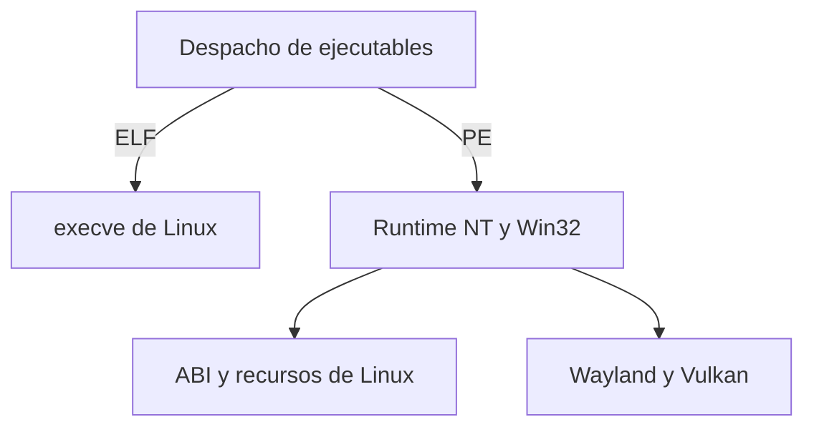

# Arquitectura

## Límites

Linux gestiona procesos, memoria, controladores y permisos. El runtime de
usuario implementa la semántica NT y Win32 observable que debe exponerse a
un proceso invitado. El código máquina AMD64 de una aplicación PE puede
ejecutarse directamente en un host AMD64, con un puente para la convención
de llamada de Microsoft x64 y las estructuras que espera la aplicación.
La versión inicial trabaja con un kernel Linux estándar.

El diagrama describe la arquitectura objetivo. El prototipo implementa
el contador NT y un conjunto inicial de contratos Win32 y CRT.

| Módulo | Espacio y responsabilidad | Estado |
| --- | --- | --- |
| Reconocimiento y carga | Usuario. Distinguir ELF y PE por cabeceras. Conservar el camino ELF de Linux. Validar arquitectura y rangos PE, mapear secciones, resolver bibliotecas y preparar la entrada. | Perfiles PE32+ AMD64 de laboratorio y lectura de importaciones directas en archivos externos. |
| NTDLL y Win32 | Usuario. Tipos de ancho fijo, exportaciones con ABI Microsoft, traducción explícita de errores, PEB, TEB, TLS y excepciones. Las bibliotecas Win32 se apoyan en servicios NT con contratos separados. | Contador NT y 165 puntos de entrada Win32 y CRT de Mines con perfiles probados. |
| Objetos y procesos | Usuario. Tablas de handles por proceso con acceso, herencia, duplicación, nombres y vida útil. Un broker por entorno podrá coordinar recursos compartidos si los casos entre procesos lo requieren. | Compartición local de archivos y salida del proceso de prueba con estado de 32 bits. |
| Recursos de Linux | Kernel y UAPI existentes. Memoria con `mmap` y `mprotect`, descriptores para recursos y `ntsync` opcional para primitivas de espera. | Relojes Linux, memoria, `openat2` y `timerfd` en uso. |
| Gráficos | Usuario. USER y win32u gestionan ventanas, eventos, entrada y portapapeles. DXVK y VKD3D-Proton aportan Direct3D sobre Vulkan. RADV usa la UAPI DRM de amdgpu. | Ventanas SDL 2, superficies GDI, teclado, ratón y temporizadores. |
| Escritorio | Usuario. Lanzador KDE, asociación MIME y estado separado por aplicación. El instalador PE usa la misma política y el mismo entorno que el lanzador. | RPM de diagnóstico preparado. |
| Pruebas | Usuario y CI en Linux. Contratos documentados, PE sintéticos y mediciones. | Linux y PE controlado comprobados. |

## Ruta de laboratorio

GCC compila una función sin dependencias con ABI Microsoft x64. GNU
binutils enlaza la sección de código como un PE32+ AMD64. El host ELF
contiene esos bytes, comprueba el perfil de cabeceras y copia `.text` a
memoria privada. La página pasa de lectura y escritura a lectura y
ejecución antes de la llamada. El host entrega en RCX un callback con ABI
Microsoft que enlaza con la implementación en C mediante el ABI de Linux.

Los perfiles de importación usan PE generados por MinGW-w64. Los dos
del contador admiten una importación cada uno y el de escritorio admite
13 nombres distribuidos entre USER32 y GDI. El anfitrión obtiene las
direcciones del registro de equivalentes mediante una lista cerrada. Admite
`.text` e `.idata` y la sección opcional `.rdata`, con un máximo de
una página por sección. Conserva sus direcciones relativas y escribe el
puntero del puente Microsoft x64 en la IAT. El código queda en lectura
y ejecución y las secciones de datos en solo lectura.
El resto del mapeo queda inaccesible. El anfitrión ejecuta exclusivamente
los bytes del archivo generado e incrustado en el build.

El auditor de importaciones inspecciona archivos AMD64 sin mapear código
para ejecución. Lee descriptores múltiples e importaciones por nombre
y ordinal. El recuento cubre las importaciones directas.

Quedan pendientes las relocaciones generales, TLS, la carga de aplicaciones
externas y el arranque NT de procesos. La ejecución de archivos externos
requiere su propio diseño de aislamiento.

Referencias [PE/COFF](https://learn.microsoft.com/en-us/windows/win32/debug/pe-format) ·
[ABI Microsoft x64](https://learn.microsoft.com/en-us/cpp/build/x64-calling-convention) ·
[`ms_abi` en GCC](https://gcc.gnu.org/onlinedocs/gcc/x86-Function-Attributes.html).

## Contrato inicial

Los primeros puntos de entrada de Mines usan el ABI Microsoft x64.
Los valores Win32 de tipo DWORD y BOOL tienen 32 bits. El contador de
rendimiento ocupa 64 bits y requiere una salida válida y alineada.
El adaptador Win32 devuelve TRUE cuando el backend escribe el contador
y FALSE cuando el backend comunica un fallo. Los identificadores de
proceso e hilo identifican al proceso y al hilo Linux que ejecutan el
fixture. El último error es un DWORD independiente por hilo.

Las rutinas de C trabajan con búferes y cadenas válidos de la prueba.
La asignación y liberación comparten el heap del anfitrión con el modo
de asignación inicial del runtime. Los tamaños son de 64 bits y las
cadenas anchas de Windows usan unidades UTF-16 de 16 bits. El comparador
de qsort entra de vuelta al invitado mediante el ABI Microsoft x64.
La cobertura de errores del CRT, los punteros invitados inaccesibles y
el aislamiento del heap pertenecen a etapas posteriores.

`NtQueryPerformanceCounter` escribe un contador de 64 bits y, si se
solicita, su frecuencia. La implementación usa tiempo desde el arranque
que incluye suspensión y devuelve ticks de 100 ns con frecuencia fija
de 10 MHz. Una salida obligatoria nula devuelve `0xC0000005`.
Un fallo de reloj o una conversión fuera de rango devuelve
`0xC0000001` sin modificar salidas. Esos dos últimos casos se originan
en el anfitrión y se prueban con un reloj simulado en Linux.
Las salidas no nulas deben ser objetos de 64 bits escribibles. La entrega
de fallos de memoria invitada, los efectos de escrituras parciales y el
orden exacto al solapar punteros se tratan en tareas posteriores.

La prueba de referencia compara estados y relaciones. El valor absoluto
del contador y la frecuencia concreta pueden variar por plataforma.

Referencias [Contrato NT](https://learn.microsoft.com/en-us/windows/win32/devnotes/ntqueryperformancecounter) ·
[QPC y suspensión](https://learn.microsoft.com/en-us/windows/win32/sysinfo/acquiring-high-resolution-time-stamps) ·
[Relojes Linux](https://man7.org/linux/man-pages/man2/clock_gettime.2.html).

## Decisiones de integración

- **Cargador.** El lanzador futuro clasifica por formato, deriva ELF al
  `execve` habitual y resuelve el backend PE antes de ejecutar. En PE se
  validan tamaños, límites, RVA, permisos por sección, importaciones y
  dependencias. Cada categoría fuera de alcance falla de forma
  explícita. La futura asociación MIME se prueba antes de considerar
  `binfmt_misc` a nivel de sistema. [Cargador ELF Linux](https://github.com/torvalds/linux/blob/v6.14/fs/binfmt_elf.c) ·
  [binfmt_misc](https://docs.kernel.org/admin-guide/binfmt-misc.html).
- **Sincronización.** Un backend comprueba acceso a `/dev/ntsync`.
  Cada apertura define un espacio de objetos. Los descriptores y las
  esperas quedan en la UAPI existente. La capa NT traduce derechos,
  tiempos, resultados de espera, APC y vida de los hilos. La ruta
  alternativa debe cubrir la semántica cuando la UAPI no esté accesible.
  [UAPI Linux 6.14](https://docs.kernel.org/6.14/userspace-api/ntsync.html).
- **Gráficos.** KWin sigue siendo el compositor. El puente de usuario
  convierte ventanas y eventos Win32 en superficies y eventos Wayland.
  La presentación Vulkan usa WSI y el cargador del sistema. Un puente
  de D3D debe definir cómo sus DLL obtienen el servicio Vulkan y
  comparten DXGI. XWayland se evalúa solo para los programas que lo
  requieran. [Wayland](https://wayland.freedesktop.org/architecture.html) ·
  [Vulkan Wayland WSI](https://docs.vulkan.org/refpages/latest/refpages/source/VK_KHR_wayland_surface.html) ·
  [RADV](https://docs.mesa3d.org/drivers/radv.html).
- **Escritorio y seguridad.** Un `.desktop` delega en un ejecutable
  sin shell, valida el tipo del archivo y respeta la política de
  confianza. El entorno por aplicación debe aislar directorios y
  definir permisos de red, archivos y dispositivos. Los prefijos
  aíslan configuración, por lo que hace falta una frontera adicional
  para ejecutar software de terceros. La selección de backend debe
  quedar visible en el diagnóstico y poder fijarse por aplicación.
  [Desktop Entry](https://specifications.freedesktop.org/desktop-entry/latest/) ·
  [Shared MIME-info](https://specifications.freedesktop.org/shared-mime-info/latest/).

La adición de código al kernel exige un caso reproducible que la UAPI
existente no pueda resolver, pruebas de concurrencia y degradación,
revisión de seguridad y una vía razonable de mantenimiento upstream.
