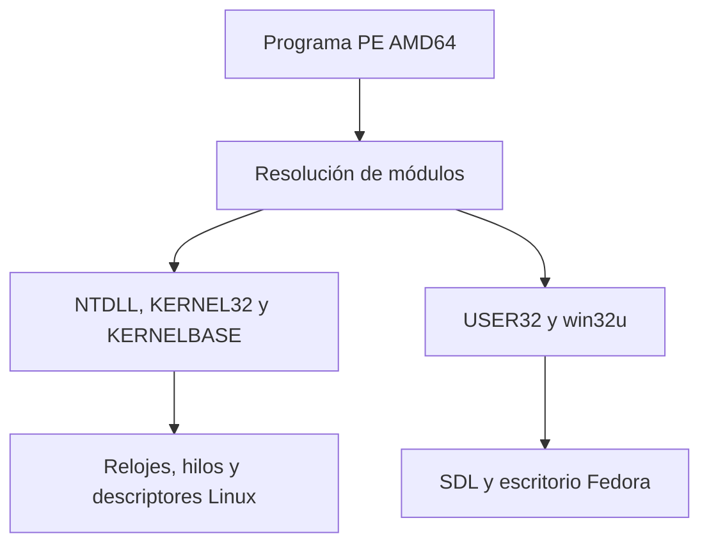

# Capa Kernel/User en Fedora

El lanzador ejecuta PE AMD64 dentro del entorno aislado existente. El
runtime de usuario resuelve los módulos del invitado y conecta sus
contratos con los servicios del kernel y del escritorio Linux.
La instalación de Fedora incorpora esta capa con el mismo RPM y el mismo
instalador de usuario del runtime.

| Contrato compartido | Implementación Linux |
| --- | --- |
| Importación PE por nombre u ordinal y `LoadLibrary`/`GetProcAddress` | Registro de módulos incorporados. Los nombres de API sets reconocidos se resuelven al mismo módulo que sus nombres canónicos. `KERNELBASE` reutiliza los equivalentes Win32 del sistema. |
| `NtQuerySystemTime` y `GetSystemTimeAsFileTime` | `CLOCK_REALTIME`, época de 1601 y unidades de 100 ns. |
| `NtDelayExecution`, `Sleep` y esperas de objetos | Plazos relativos monotónicos, plazos absolutos de reloj de pared y esperas de glibc. |
| Eventos y cierre | NTDLL y Win32 comparten la tabla de objetos. El cierre de archivos usa los mismos descriptores confinados del runtime. |
| `GetLastError`, `SetLastError` y las variantes `Rtl*LastWin32Error` | El DWORD `LastErrorValue` vive en `GS:0x68` del TEB de cada hilo invitado. |
| Consultas USER32 y win32u | `NtUserGetCursorPos`, `NtUserGetForegroundWindow`, `NtUserGetAsyncKeyState` y `NtUserGetKeyState` usan el escritorio SDL del runtime. |

## ABI y alcance

- Los puntos de entrada usan el ABI Microsoft x64. `NTSTATUS`, `ULONG` y
  los estados de evento tienen 32 bits. `BOOLEAN` ocupa 8 bits, los handles
  ocupan 64 bits y `OBJECT_ATTRIBUTES` ocupa 48 bytes. Las salidas deben ser
  escribibles. Las funciones `Nt*` devuelven `NTSTATUS` y mantienen
  `LastErrorValue`. Los adaptadores Win32 traducen sus propios errores.
- Los eventos son anónimos o tienen nombres locales y pertenecen al proceso.
  Los nombres aceptan el subconjunto ASCII de `Local\\` o
  `\\BaseNamedObjects\\`, con coincidencia insensible a mayúsculas cuando
  se pide `OBJ_CASE_INSENSITIVE`. Se aplican los derechos
  de espera y modificación del handle. `NtDuplicateObject` y `DuplicateHandle`
  crean handles distintos para el mismo estado de evento, hilo o proceso;
  cerrar el original no invalida el duplicado. Se admiten derechos reducidos
  para eventos y se comprueba que no superen los del handle original.
  `GetHandleInformation` expone el indicador de herencia del duplicado.
  Los handles de archivo se duplican mediante `fcntl(F_DUPFD_CLOEXEC)` y
  comparten posición de lectura/escritura. Para archivos únicamente se admite
  `DUPLICATE_SAME_ACCESS`, sin ampliación ni reducción arbitraria de derechos.
  `DUPLICATE_CLOSE_SOURCE` cierra el origen tras duplicar con éxito.
  La duplicación se limita a handles dentro del proceso invitado actual:
  NO hay broker de objetos entre procesos, y el indicador de herencia no
  implementa todavía herencia real hacia procesos hijos.
  Se pueden esperar hasta 64 objetos
  de la misma tabla, incluidos eventos, hilos y procesos hijos. La espera
  múltiple solo consume autoeventos si se satisface el conjunto solicitado.
  El cierre concurrente despierta al hilo y devuelve handle inválido.
  Los objetos con nombre compartidos entre procesos, las rutas de sesión
  `Global\\`, los nombres Unicode generales, los APC y `/dev/ntsync`
  quedan fuera de este perfil.
- Los API sets se seleccionan por nombre completo y versión registrada.
  Se acepta la ruta virtual `C:\Windows\System32\` para los módulos
  incorporados. El mismo registro sirve para el auditor, la IAT y las
  consultas dinámicas. Una DLL o función desconocida produce el error
  correspondiente.
- Las consultas de escritorio usan la ventana, el foco y el teclado del
  invitado que conoce SDL. Las llamadas directas a números de syscall NT,
  los controladores Windows y la carga general de DLL PE quedan pendientes.

## TLS dinámico del TEB AMD64 (implementación incremental)

El TEB invitado reserva ahora espacio suficiente para los 64 `TlsSlots`
nativos de Windows x64 en `GS:0x1480` y el puntero a
`TlsExpansionSlots` en `GS:0x1780`. El runtime expone `TlsAlloc`,
`TlsFree`, `TlsGetValue` y `TlsSetValue` tanto por KERNEL32 como
por su alias KERNELBASE. Puede asignar los **1088 índices** (64 directos
y 1024 adicionales), reservando la memoria de expansión individualmente
por hilo solo cuando se utiliza. Los valores son independientes de la
plantilla TLS estática del PE accesible desde `GS:0x58`.
Las entradas y salidas anidadas conservan el hilo invitado actual y
restauran el estado previo de GS.

La asignación de índices es compartida por el proceso y está
sincronizada. Una generación asociada a cada índice impide que liberar y
reasignar un slot revele valores antiguos de otros hilos. `TlsGetValue`
devuelve `NULL` y limpia `LastError` cuando el índice válido está vacío.
El código PE generado para la prueba lee directamente `GS:0x1480`
y `GS:0x1780`, crea hilos adicionales, verifica el aislamiento y
comprueba la reutilización y el agotamiento de los 1088 índices.

**No es un TEB completo:** el cargador admite TLS estático de DLL
importadas antes de crear el primer hilo, pero falta inicializar TLS en hilos
existentes ante LoadLibrary dinámico y gestionar la descarga/reutilización
de índices. También sigue pendiente la política completa del cargador Ldr,
campos adicionales de TEB/PEB y servicios NT asociados. Los 1088 slots
Win32 cubren `TlsAlloc` y sus operaciones afines; no completan el ABI
del sistema de hilos de Windows ni sus interacciones con el cargador.

Ejecutar `make check-pe-teb-tls` desde Linux comprueba la implementación
Win32 desde un PE32+ AMD64 compilado con MinGW. La CI lo incluye en Ubuntu,
UBSan y Fedora.

## Consultas nativas del proceso, memoria y excepciones

El perfil nativo amplía NTDLL con
`NtQueryInformationProcess` (clases Basic y WOW64), `NtQueryInformationThread`
(Basic) y `RtlGetCurrentPeb` para el proceso/hilo actual. Las estructuras
devueltas mantienen el ABI AMD64 de 48 bytes. No se prometen consultas de
procesos arbitrarios ni clases no implementadas.

`NtAllocateVirtualMemory`, `NtFreeVirtualMemory`,
`NtProtectVirtualMemory` y `NtQueryVirtualMemory` traducen al gestor
de memoria del proceso invitado. Conservan `LastError` porque son API
NTSTATUS. No se permiten operaciones sobre procesos remotos ni vistas de
sección no gestionadas.

`CREATE_SUSPENDED` bloquea un hilo antes de ejecutar código invitado.
`ResumeThread` y `NtResumeThread` liberan esa espera y devuelven el
contador anterior. Esto no equivale a suspender asíncronamente un hilo
que ya está ejecutándose.

Los manejadores VEH registrados con `AddVectoredExceptionHandler` y
`RemoveVectoredExceptionHandler` se invocan en orden para las excepciones
software canalizadas por `RaiseException`, antes del recorrido SEH.
No traducen por sí mismos señales síncronas Linux en excepciones Windows.
Véase [estado de los siete componentes](nt-core-readiness.md).

## Verificación

`make -j2 check check-pe check-pe-import check-pe-kernel-user` ejecuta dos
PE MinGW-w64 de control sobre Linux. El primero combina importaciones
NTDLL, KERNEL32, KERNELBASE y un API set de sincronización. Comprueba
relojes, espera múltiple, derechos, hilos y escrituras directas al TEB.
El primer PE también duplica eventos y hilos con handles independientes,
comprueba límites de permisos y cierre del original, y duplica un descriptor de
archivo para verificar que puede seguir usándose después del cierre del
original. La nueva prueba `check-pe-named-events` cubre nombres de evento
locales, apertura por nombre, permisos, espera, consulta y cierre de la última
referencia. Los handles compartidos entre procesos siguen fuera de alcance.

El segundo combina USER32, win32u y un API set de escritorio, y prueba
también el cargador dinámico y los errores de módulo o símbolo ausente.
Se ejecutaron en Linux 6.18.57 AMD64 con GCC 14.2 y MinGW-w64 GCC 14,
también con `-fsanitize=undefined -fno-sanitize-recover=all`.

Las referencias de ABI son las cabeceras `winternl.h`, `ntdef.h` y
`ntstatus.h` de MinGW-w64 y los contratos públicos de Windows. El mapa de
módulos y las firmas win32u se contrastaron con Wine 11.0.
[NtCreateEvent](https://learn.microsoft.com/en-us/windows-hardware/drivers/ddi/ntifs/nf-ntifs-ntcreateevent) ·
[WaitForMultipleObjects](https://learn.microsoft.com/en-us/windows/win32/api/synchapi/nf-synchapi-waitformultipleobjects) ·
[Windows API sets](https://learn.microsoft.com/en-us/windows/win32/apiindex/windows-apisets) ·
[Wine 11.0 API sets](https://github.com/wine-mirror/wine/blob/wine-11.0/dlls/apisetschema/apisetschema.spec) ·
[Wine 11.0 win32u](https://github.com/wine-mirror/wine/blob/wine-11.0/dlls/win32u/win32u.spec).

## Apertura de archivos desde NTDLL

`NtCreateFile`, `NtOpenFile` y sus variantes `Zw` usan la apertura
confinada de Win32. La ruta NT absoluta `\??\C:\` se traduce al disco C:
invitado. El perfil admite archivos normales con apertura, creación y
sobrescritura, acceso de lectura o escritura y uso síncrono. Las rutas
con directorio raíz mediante handle, los directorios y las opciones de
E/S especializadas quedan fuera del perfil. Se conserva LastError y se
devuelve NTSTATUS junto al resultado de apertura en IO_STATUS_BLOCK.

El PE de control crea el archivo por NTDLL, escribe por Win32, lo vuelve
a abrir por NTDLL y lee por Win32. Comprueba también el cierre cruzado,
el error de fichero ausente y la conservación de LastError.

## APC de usuario y esperas alertables (continuación del núcleo de hilos)

El runtime incorpora una cola acotada de APC por hilo invitado
gestionado por la tabla de handles NT. `QueueUserAPC`,
`NtQueueApcThread` y `NtTestAlert` entregan callbacks únicamente
en el **hilo de destino** al ejecutar `SleepEx`,
`NtDelayExecution(alertable=TRUE)` o `WaitFor*ObjectEx(alertable=TRUE)`.
`NtQueueApcThread` usa tres argumentos y `QueueUserAPC` uno,
siempre bajo el ABI Microsoft x64. Los derechos THREAD_SET_CONTEXT
se validan para cada HANDLE, los índices de cola están acotados,
y los callbacks pendientes se liberan cuando termina el hilo.

No se ejecutan callbacks desde el hilo que los encola ni desde
un manejador de señal de Linux. Los waits **no alertables** no
despachan APC. Este perfil no implementa APC de kernel,
`NtQueueApcThreadEx`, cancelación de APC, hilos arbitrarios
externos, ni `IoCompletionPort`. La API `NtTestAlert` ejecuta
como máximo una APC por llamada; esto no supone compatibilidad
completa de todas las variantes del contrato Windows.

La prueba `make check-pe-apc` genera un PE AMD64 independiente:
suspende un hilo, le encola APC Win32/NT, lo reanuda, verifica el
ID del hilo de callback, el orden de entrega, los estados
`WAIT_IO_COMPLETION`/STATUS_USER_APC, la preservación de
esperas no alertables y los derechos limitados.

## Nuevos contratos del cargador, PEB y objetos NT

**DLL:** `pe_dll_graph` mapea archivos PE32+ AMD64 regulares, de
nombre simple, desde el directorio aislado proporcionado por el lanzador.
Resuelve importaciones estáticas y forwarders, adjunta dependencias antes
que sus importadores y enlaza `LoadLibrary`, `GetProcAddress`,
`GetModuleHandle` y `FreeLibrary` con el registro común. Distingue
nombres ASCII de DLL sin importar mayúsculas/minúsculas, rechaza nombres
ambiguos y no sigue enlaces simbólicos. `DllMain` se invoca con
`DLL_PROCESS_ATTACH/DETACH` y `DLL_THREAD_ATTACH/DETACH` cuando
corresponde, con el TEB invitado activo. Las DLL con directorio TLS
importadas antes de entrar al primer hilo obtienen un índice propio
de 1 a 63 en `GS:0x58`; sus plantillas se copian por hilo y se ejecutan
los callbacks TLS antes de DllMain. Se mantienen mapeadas hasta el fin
del proceso para evitar referencias TLS colgantes. Una DLL nueva con TLS
cargada después del arranque se rechaza expresamente: falta inicializar
de forma segura todos los hilos existentes. `LoadLibraryEx`
con flags de datos/recursos no ejecuta bibliotecas externas en este perfil.

**PEB:** `PEB->Ldr` (offset 0x18) apunta a un prefijo válido
`PEB_LDR_DATA` con anillos de carga, memoria e inicialización.
Los anillos contienen la imagen EXE principal y las DLL locales ya
adjuntas, con base, entrada, tamaño y nombre completo/corto UTF-16.
Se eliminan al descargar la DLL. Esto sigue sin ser un PEB/LDR_DATA
completo ni expone todos los estados de la carga nativa de Windows.

**Objetos NT:** `NtCreateSemaphore`, `NtOpenSemaphore`,
`NtQuerySemaphore`, `NtReleaseSemaphore` y las API Win32
`CreateSemaphoreW`, `OpenSemaphoreW`, `ReleaseSemaphore`
comparten la tabla de handles de eventos, un mutex y el namespace
local ASCII. Al adquirir se consume una unidad del contador
de forma atómica; las esperas `WaitAll` consumen todas las
unidades solo cuando todos los objetos están señalizados.
El exceso sobre el máximo devuelve
`STATUS_SEMAPHORE_LIMIT_EXCEEDED` / `ERROR_TOO_MANY_POSTS`.
Los nombres de eventos y semáforos se excluyen mutuamente cuando
el tipo no coincide. No existe namespace global ni sincronización
entre procesos.

**Hilos:** `OpenThread` permite abrir handles adicionales de hilos
creados por el runtime; `GetThreadId` y
`NtQueryInformationThread` obtienen IDs y el TEB mientras el hilo
está vivo, o el estado final tras su terminación. Los accesos están
sujetos a derechos y la dirección TEB deja de exponerse al liberar
la pila. No se admite abrir hilos arbitrarios del anfitrión,
suspender hilos activos de forma asíncrona, APC o manipulación
completa de contextos.

La CI comprueba estos contratos con `make check-pe-image
check-pe-native-core check-pe-core-objects check-pe-teb-tls`.
Siguen siendo **subconjuntos** de los cuatro primeros bloques
críticos, no una declaración de compatibilidad general.

## E/S síncrona nativa del mismo handle (continuación de PR #61)

El puente NTDLL extiende ahora las operaciones abiertas mediante Win32
o `NtCreateFile`/`NtOpenFile` con cinco entradas de NTDLL y sus alias
`Zw`: `NtReadFile`, `NtWriteFile`, `NtQueryInformationFile`,
`NtSetInformationFile` y `NtFlushBuffersFile`.

- La lectura/escritura síncrona con `ByteOffset == NULL` utiliza la
  posición compartida del descriptor Linux, igual que `ReadFile` y
  `WriteFile`; las lecturas/escrituras con `ByteOffset >= 0` usan
  `pread`/`pwrite` sin cambiar la posición compartida.
- El `IO_STATUS_BLOCK` informa de `NTSTATUS` y bytes transferidos.
  Una lectura sin datos con longitud positiva devuelve
  `STATUS_END_OF_FILE`. Se conserva el `LastError` Win32 del hilo.
- `FileStandardInformation` (clase 5) devuelve tamaño del archivo,
  bloques asignados y número de enlaces; `FilePositionInformation`
  (clase 14) permite consultar y mover la posición del descriptor.
  `FileEndOfFileInformation` (clase 20) permite truncar un archivo con
  permiso de escritura. `NtFlushBuffersFile` utiliza `fsync`.
- La implementación reutiliza la tabla de handles y sus comprobaciones
  de acceso; no abre rutas Linux arbitrarias ni crea un segundo espacio
  de nombres.

**Límites del perfil:** E/S asíncrona, eventos/APC, completion ports,
offsets especiales NT, cancelación, oplocks, acceso entre procesos y
otras clases de `FILE_INFORMATION_CLASS` siguen pendientes. Los
descriptores explícitamente posicionados no actualizan el puntero
compartido. Esto no pretende reproducir toda la semántica de NTFS.

`make check-pe-nt-io` compila un PE AMD64 controlado que mezcla
NTDLL y Win32 para probar escritura, lectura, EOF, offsets, información
de tamaño, posicionamiento, truncado, flush, duplicación y cierre de
handles, derechos reducidos, argumentos inválidos y conservación de
`LastError`. Se integra en los tres recorridos de CI, incluido Fedora.

